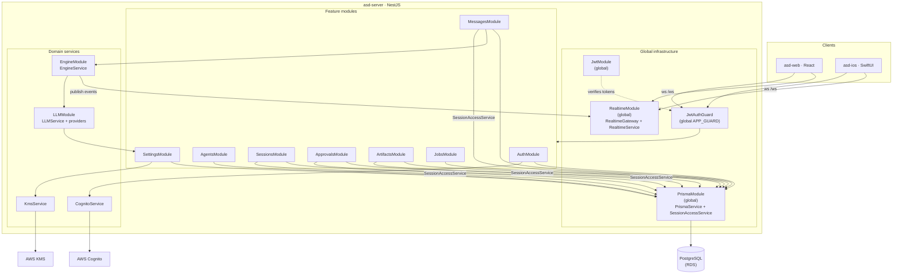
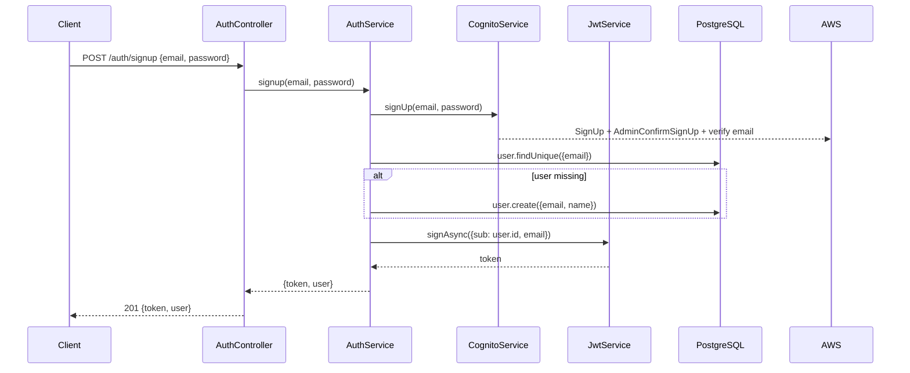
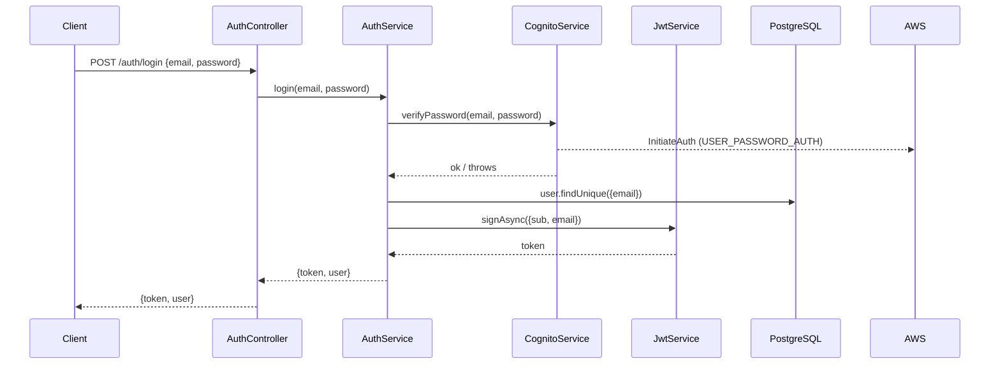
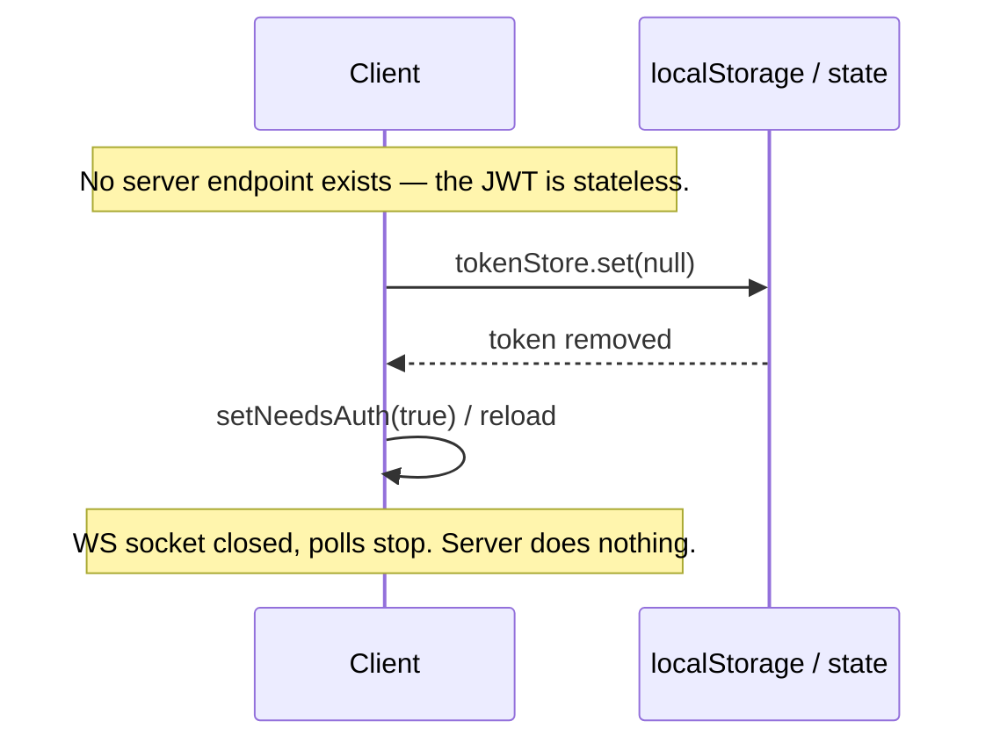
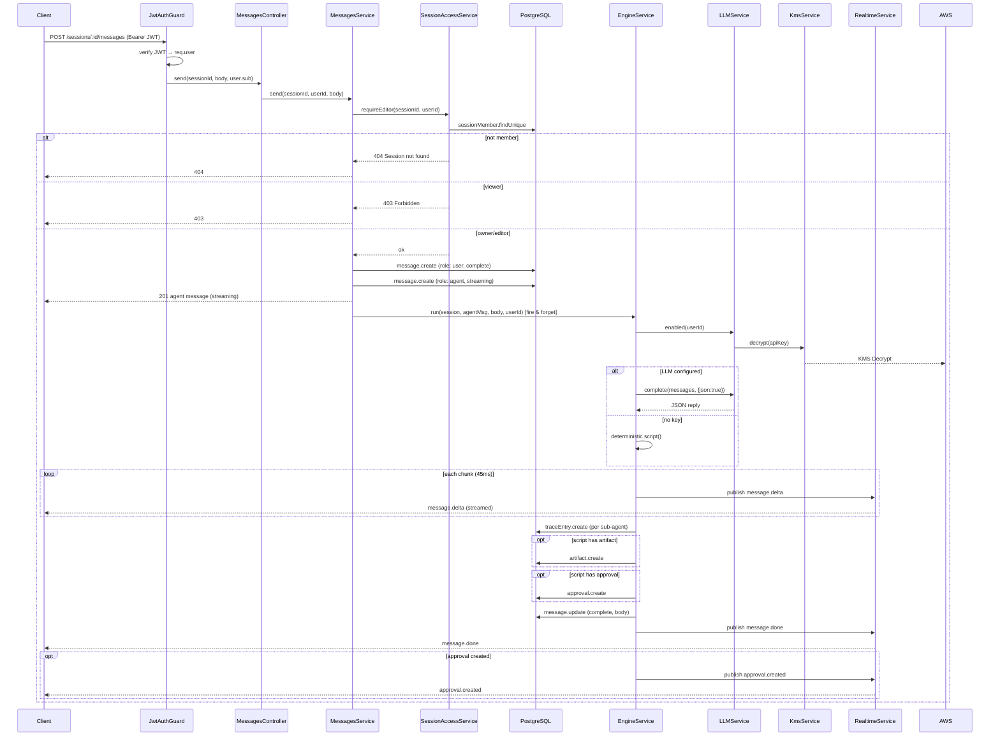
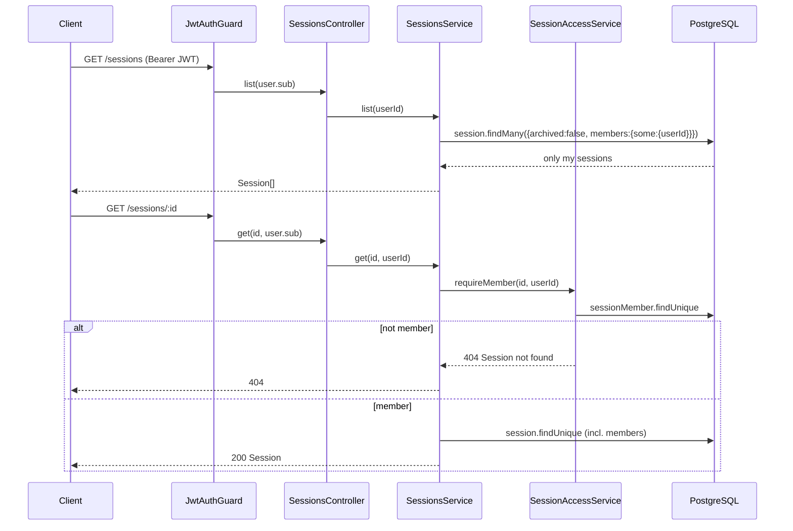
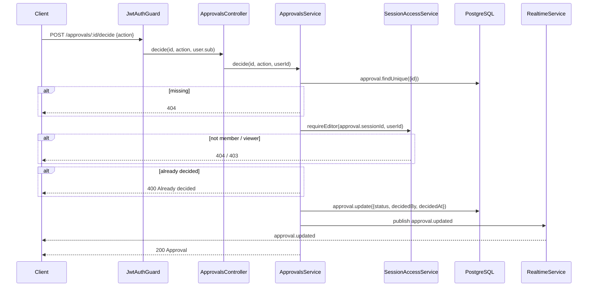
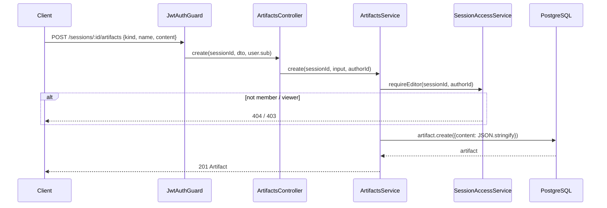
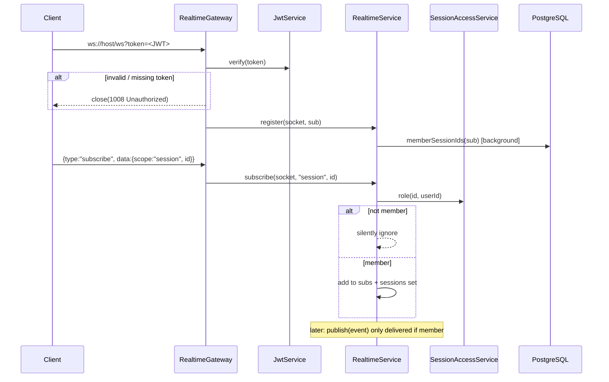

# Backend flows

Call-flow diagrams for `asd-server` (NestJS + Prisma + PostgreSQL). Mirrors
the live code in `asd-server/src`. All routes except `@Public()` require a JWT
(`Authorization: Bearer <token>`); session-scoped reads require membership and
writes require `owner`/`editor`.

## High-level module map

## 1. Sign up

## 2. Login

## 3. Logout (client-side only)

## 4. Send a message (full engine turn)

## 5. List / get sessions

## 6. Decide an approval

## 7. Create an artifact

## 8. Realtime connect + subscribe

